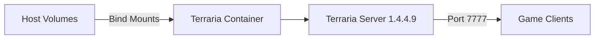

# Architecture

## Overview

`terraria-server-container` packages the official Terraria dedicated server binary into a minimal container image running under Debian Linux. The container runs as an unprivileged user and mounts world saves and server configurations directly from the host.

## Core Components

- **Base Image**: Built on `debian:12-slim` with required runtime libraries for the Linux dedicated server.
- **Dedicated User**: Runs strictly as non-root user `terraria` for process isolation.
- **Storage Mounts**: Host bind mounts for `serverconfig.txt` and `data/Worlds` persist worlds and settings across container rebuilds.

## Invariants & Guarantees

- **Stock Upstream Binary**: Uses official, unpatched Terraria dedicated server binaries directly from Re-Logic.
- **Persistence Boundary**: Worlds and configuration live solely on host bind mounts. Container teardowns never destroy world state.
- **Interactive Console**: Container starts with stdin open and pseudo-TTY enabled, allowing administrators to attach directly to the server console.
